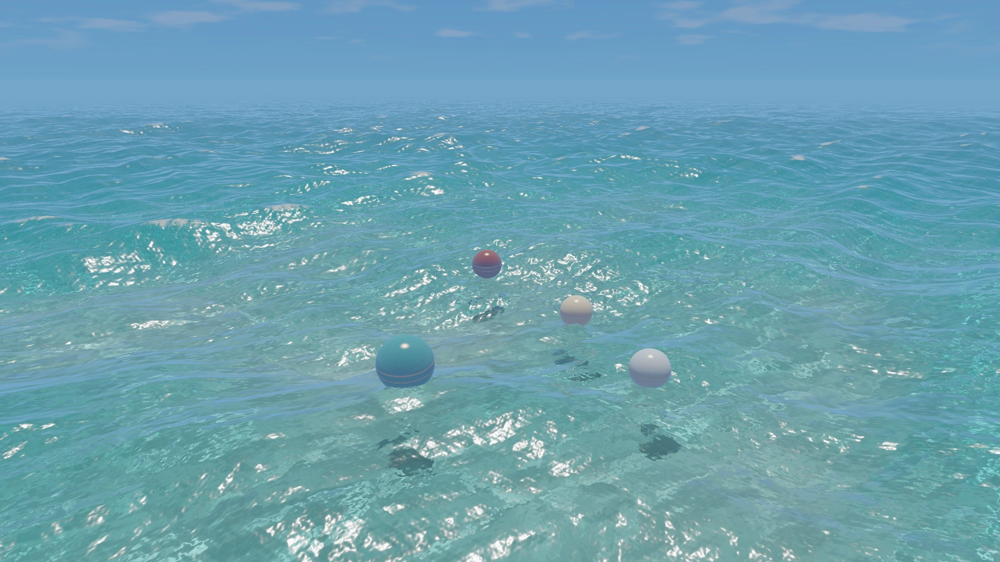
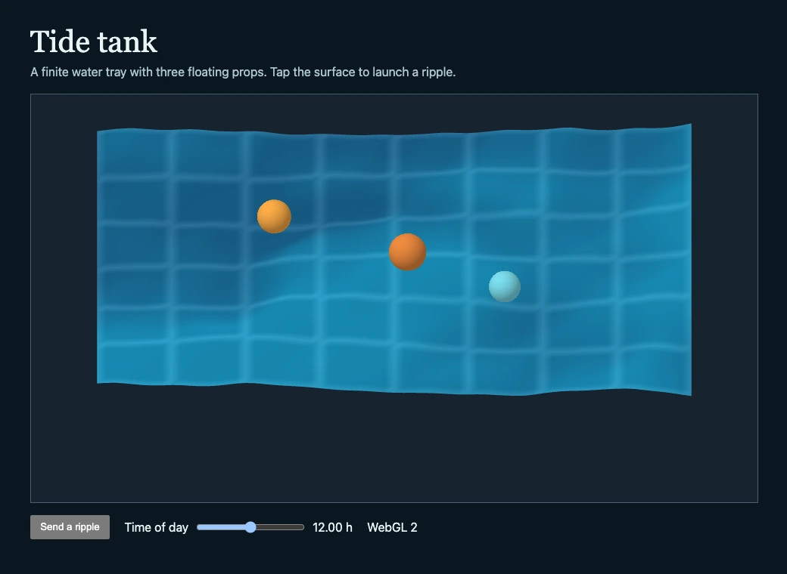

# Cinematic Skills

**Portable agent skills for real-time water, light and motion.** Each skill includes implementation guidance, a reusable ES module and a runnable example with assertions. The library is MIT-licensed and has no runtime packages.

## Flagship showcase · Glasswater 1.0 — Lagoon

Disturb the waves, move the sun and watch floating lights illuminate the bed. The six skills come from the corrected WebGL 2 renderer. [**Open the interactive Glasswater demo →**](https://chatgpt.256pages.com/glasswater/)



[Underwater illumination after dark](media/lagoon-night.webp) · [Corrected Glasswater source](https://github.com/edmondyip/glasswater/tree/250daa455f3bf66718ec52e893d963644844e00c)

## Skill catalogue

| Skill | What it implements | Minimal example |
| --- | --- | --- |
| [interactive-ocean](skills/interactive-ocean/SKILL.md) | Fixed-step local height field, pointer strokes and directional analytic swell | [Propagation and stability](skills/interactive-ocean/scripts/example.mjs) |
| [underwater-caustics](skills/underwater-caustics/SKILL.md) | Refract light to a shaped bed and estimate geometric focusing | [Projection and focusing](skills/underwater-caustics/scripts/example.mjs) |
| [refracted-shadows](skills/refracted-shadows/SKILL.md) | Soft spherical occlusion along air and water paths, with flux-weighted visibility | [Finite path occlusion](skills/refracted-shadows/scripts/example.mjs) |
| [underwater-lighting](skills/underwater-lighting/SKILL.md) | Chromatic attenuation and submerged emitters lighting the bed | [Depth and lamps](skills/underwater-lighting/scripts/example.mjs) |
| [floating-object-physics](skills/floating-object-physics/SKILL.md) | Spring heave, slope-driven drift and horizontal sphere contacts | [Contacts and heave](skills/floating-object-physics/scripts/example.mjs) |
| [procedural-day-night](skills/procedural-day-night/SKILL.md) | Continuous artistic celestial clock, disk clipping and horizon-safe fog | [Four horizon crossings](skills/procedural-day-night/scripts/example.mjs) |

## Install in a coding agent

The folders use the [Agent Skills format](https://agentskills.io/specification). Copy a complete skill folder to the agent’s project skill directory so its scripts stay with the instructions. Run these commands from the target project. Set `skill_dir=.agents/skills` for [Codex](https://developers.openai.com/codex/skills/) or `skill_dir=.claude/skills` for [Claude Code](https://code.claude.com/docs/en/skills).

```sh
library="$(mktemp -d)/cinematic-skills"
git clone --depth 1 https://github.com/edmondyip/cinematic-skills.git "$library"
skill_dir=.agents/skills
mkdir -p "$skill_dir"

# Install just one. Choose any catalogue name.
cp -R "$library/skills/interactive-ocean" "$skill_dir/"
cp "$library/LICENSE" "$skill_dir/interactive-ocean/LICENSE"
```

To install all six into the selected directory, run this using the same `library` and `skill_dir` variables.

```sh
for source in "$library"/skills/*; do
  name="${source##*/}"
  cp -R "$source" "$skill_dir/"
  cp "$library/LICENSE" "$skill_dir/$name/LICENSE"
done
```

For another tool that supports Agent Skills, use its documented discovery directory. In your prompt, name the skill and state the material, geometry or input system it should connect to. For example, ask to “use interactive-ocean to add a continuous pointer wake to this existing water mesh.”

## Run and combine

From a clone, run one example with Node.js 20+ or run all six. No npm install is needed.

```sh
node skills/interactive-ocean/scripts/example.mjs
for example in skills/*/scripts/example.mjs; do node "$example" || exit 1; done
```

**Tide tank** imports the ocean, float and day/night modules into a finite WebGL 2 tray. Serve the clone with `python3 -m http.server 8080 --bind 127.0.0.1` and open [the local tide tank](http://127.0.0.1:8080/examples/tide-tank.html). Use **Send a ripple** or tap the water, then set the clock to 22 h to check the lighting change. [Scene source](examples/tide-tank.mjs)



Match a Y-up world and use one clock for rendering and simulation. Pass the displayed height sampler to the float skill. For underwater optics, supply the same water normals and sun direction to the caustic projector and pass its finite light segments to the shadow function. Shade the actual refracted bed hit with the underwater lighting skill. Each module has its own inputs and can be used without the other five.

The reference optics use geometric approximations. The water is a height field, and float contacts operate in the horizontal plane. [Verification and integration limits](VERIFICATION.md)

[MIT licence](LICENSE) · Original models and showcase assets from Edmond Yip’s [Glasswater project](https://github.com/edmondyip/glasswater).
